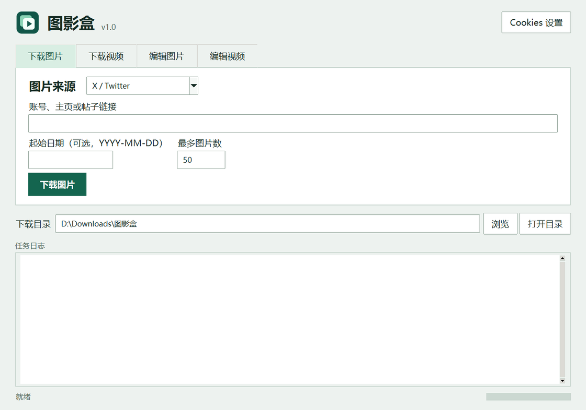
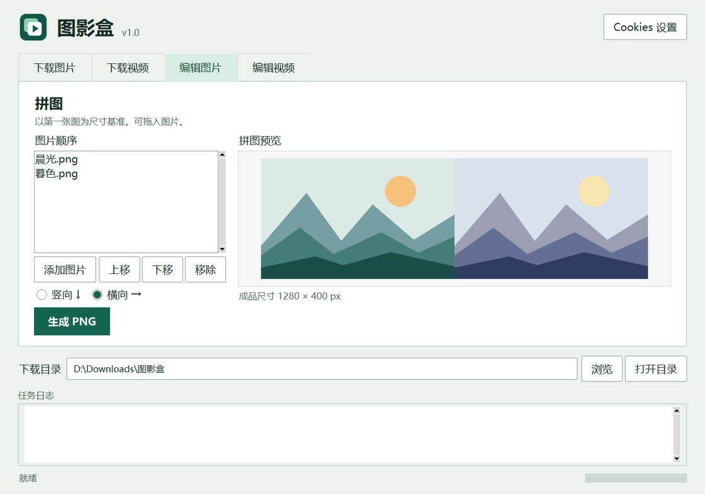

# 图影盒


图影盒是一款 Windows 便携工具，可下载图片和视频、预览并拼接图片，以及把 MKV 无损封装为 MP4。



## 功能

| 栏目 | 功能 |
| --- | --- |
| 下载图片 | 批量下载 X／Twitter 图片，可按日期和数量筛选。支持 Instagram 帖子图片和抖音图文。 |
| 下载视频 | 支持 YouTube、X／Twitter、哔哩哔哩和抖音。一行一个链接，可选下载完整播放列表。YouTube 需要处理 JavaScript 时会调用 Deno。 |
| 编辑图片 | 支持拖入、排序、横向或竖向拼接，在导出 PNG 前可实时查看预览和成品尺寸。 |
| 编辑视频 | 用 FFmpeg 将兼容的 MKV 视频与音频轨道无损封装为 MP4。 |



## 下载与使用

1. 如果仓库已提供便携包，前往 **Releases** 下载 `tuyingbox-v1.0-windows-x64.zip`。
2. 在 Windows 64 位电脑上完整解压，双击 `图影盒.exe`。
3. 在主窗口选择下载目录。需要登录时，在 **Cookies 设置** 中为对应网站选择符合 Netscape 格式的 `.txt` 文件。

便携版带有运行所需的 Python、FFmpeg、yt-dlp、Deno 和 Chromium。窗口会跟随 Windows 显示缩放调整字号、控件和布局。

使用 Get cookies.txt LOCALLY 时，导出格式选 **Netscape**。图影盒的文件导入支持 Netscape `.txt`。JSON 和 Header String 无法直接导入。登录状态、可访问范围和平台响应会影响下载结果。请保存你有权下载的媒体。

更多操作见[使用说明](使用说明.txt)。

## 从源码运行与构建

需要 Windows x64、带 Tk 的 Python 3.14，以及可在 PowerShell 中找到的 `yt-dlp.exe`、`ffmpeg.exe`、`ffprobe.exe` 和 `deno.exe`。也可以用下方构建脚本的参数为各工具指定完整路径。

在仓库根目录运行：

```powershell
python -m venv .venv
$python = (Resolve-Path .\.venv\Scripts\python.exe).Path
& $python -m pip install -r requirements-build.txt
& $python -m playwright install chromium --only-shell
& $python src/launcher.py
```

关闭从源码运行的窗口后，构建便携包：

```powershell
.\build-portable.ps1 -Python $python
```

构建输出为 `dist\图影盒v1.0-便携版\`。运行或分发时，请随 `图影盒.exe` 保留该目录中的运行组件。工具没有加入 `PATH` 时，使用 `-YtDlp`、`-FFmpeg`、`-FFprobe` 和 `-Deno` 指定各自的 EXE 路径。Chromium 放在自定义目录时，使用 `-ChromiumDirectory` 指定 `chrome-headless-shell.exe` 所在目录。

## 反馈问题

请附上软件版本、Windows 版本、操作步骤和相关任务日志。提交前请遮住账号、个人路径和私密链接，Cookies 文件只保存在自己的设备上。

## 第三方组件

依赖和便携包组件的来源见[第三方组件说明](THIRD_PARTY_NOTICES.md)。
